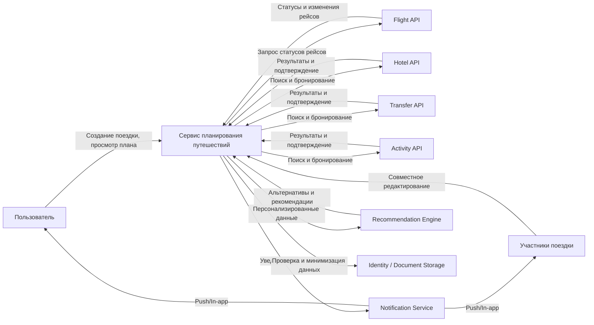

# Границы системы и допущения

## Назначение документа

Документ определяет границы сервиса планирования путешествий, внешние интеграции и базовые допущения проектирования.

---

## Область реализации

Сервис отвечает за:

- создание и ведение поездки;
- хранение состава участников;
- подбор элементов маршрута;
- управление бронированиями;
- получение статусов рейсов;
- уведомление пользователя об изменениях;
- предложение альтернатив;
- синхронизацию изменений между участниками;
- учёт офлайн-режима и последующей синхронизации;
- временное хранение данных, необходимых для бронирования.

---

## Входит в систему

| Функция | Описание |
|---|---|
| Создание поездки | Формирование сущности поездки с основными параметрами |
| Управление участниками | Добавление и исключение участников поездки |
| Поиск вариантов | Подбор перелётов, отелей, трансферов и активностей |
| Бронирование | Сохранение выбранных вариантов и связанных данных |
| Мониторинг рейсов | Получение обновлений о статусе рейса |
| Уведомления | Сообщения о задержках, отменах и изменениях |
| Рекомендации | Предложение альтернатив с учётом ограничений |
| Синхронизация | Обновление плана на устройствах участников |

---

## Не входит в систему

- фактическое выполнение услуг авиакомпанией, отелем или перевозчиком;
- выпуск билетов и паспортных документов;
- оформление виз;
- ведение бухгалтерии поставщиков;
- полная CRM-система путешествий;
- страховые продукты, не связанные с маршрутом.

---

## Внешние системы

| Система | Назначение |
|---|---|
| Flight API | Получение расписаний, статусов и изменений рейсов |
| Hotel API | Поиск и бронирование проживания |
| Transfer API | Поиск и бронирование трансферов |
| Activity API | Поиск и бронирование активностей |
| Notification Service | Отправка уведомлений пользователю |
| Identity / Document Storage | Контроль паспортных и идентификационных данных |
| Recommendation Engine | Формирование персональных рекомендаций |

---

## Допущения

- Данные о рейсах могут поступать с задержкой.
- У одного пользователя может быть несколько поездок, но в рамках кейса основной фокус — на одной активной поездке.
- Участники группы могут редактировать общий план в пределах прав доступа.
- Пользователь может быть офлайн и синхронизировать изменения позже.
- Тайм-зоны должны интерпретироваться только через явно заданные часовые пояса.
- Паспортные данные хранятся только столько, сколько необходимо для бронирования и поездки.

---

## Ограничения

- Рекомендации формируются только на основании доступных данных.
- Бронирования и альтернативы зависят от возможностей внешних API.
- Не все изменения внешних источников можно обработать мгновенно.
- Все элементы маршрута должны хранить связку с поездкой и временем последнего изменения.

---

## Открытые вопросы

1. Является ли групповой режим обязательным для MVP?
2. Какие источники статуса рейса считаются приоритетными?
3. Нужно ли хранить историю всех версий плана поездки?
4. Какие действия доступны участнику без интернета?
5. Какие поля паспортных данных хранятся в системе, а какие передаются только транзитом?
6. Как часто система должна опрашивать внешние источники статусов рейсов?

---

## Контекстная диаграмма

Исходный код диаграммы: [context.mmd](../diagrams/mermaid/context.mmd).

