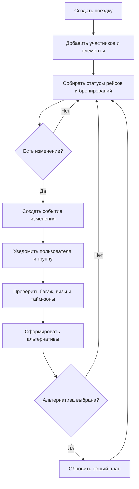

# Бизнес-процесс

## 1. Назначение документа

Документ описывает основные бизнес-процессы сервиса планирования путешествий: создание поездки, добавление участников, бронирование, мониторинг рейсов и обновление плана при изменении статуса.

---

## 2. Основные процессы

### 2.1. Создание поездки

1. Пользователь создаёт новую поездку.
2. Сервис фиксирует основные параметры: название, даты, путешественников, временную зону и при необходимости направление.
3. Сервис создаёт черновик маршрута.
4. Пользователь добавляет элементы поездки: перелёт, отель, трансфер, активности.

### 2.2. Поиск и бронирование

1. Пользователь запускает поиск перелёта, отеля, трансфера или активности.
2. Сервис обращается к внешнему API.
3. Сервис получает доступные варианты.
4. Пользователь выбирает подходящий вариант.
5. Сервис оформляет бронирование и сохраняет связанный элемент маршрута.

### 2.3. Мониторинг рейса

1. Сервис получает обновления о статусе рейса.
2. Сервис сопоставляет событие с существующей поездкой.
3. Если обнаружена задержка, отмена или существенное изменение, система создаёт событие изменения маршрута.
4. Сервис уведомляет пользователя и участников группы.

### 2.4. Пересборка маршрута

1. Сервис определяет затронутые элементы маршрута.
2. Сервис проверяет ограничения: багаж, визы, тайм-зоны, доступность внешних вариантов.
3. Сервис формирует список альтернатив.
4. Пользователь или группа принимает новое предложение.
5. Сервис обновляет общий план поездки.

---

## 3. Участники процесса

| Участник | Роль |
|---|---|
| Путешественник | Инициирует поездку, бронирования и принимает решения |
| Участник группы | Согласует изменения плана |
| Сервис планирования поездки | Управляет маршрутом и реакцией на события |
| Внешние API | Предоставляют данные и подтверждения |
| Сервис уведомлений | Передаёт события пользователю |

---

## 4. Предусловия

1. Пользователь авторизован.
2. Доступны необходимые справочники и внешние интеграции.
3. Для части сценариев уже создана поездка.
4. Для мониторинга рейса известны ссылки на нужные сегменты маршрута.

---

## 5. Основной сценарий

1. Пользователь создаёт поездку.
2. Пользователь добавляет участников и элементы маршрута.
3. Сервис получает подтверждения бронирований.
4. Сервис начинает мониторинг статуса рейсов.
5. При изменении статуса рейса сервис создаёт событие изменения.
6. Сервис уведомляет пользователя и участников.
7. Сервис анализирует затронутые участки маршрута.
8. Сервис предлагает релевантные альтернативы.
9. Пользователь или группа принимает альтернативу.
10. Сервис обновляет общий план поездки.

---

## 6. Альтернативные сценарии и исключения

| ID | Ситуация | Поведение системы | Результат |
|---|---|---|---|
| ALT-01 | Внешний API недоступен | Сервис фиксирует ошибку и предлагает повтор | Данные временно недоступны |
| ALT-02 | Пользователь офлайн | Изменения сохраняются локально и синхронизируются позже | План обновится после восстановления связи |
| ALT-03 | Альтернатива не соответствует ограничениям | Система исключает неподходящие варианты | Пользователь видит только релевантные варианты |
| ALT-04 | Участники группы не согласовали изменение | Новый план не фиксируется | Маршрут остаётся в согласовании |
| ALT-05 | Рейс изменился повторно | Сервис пересчитывает маршрут заново | Актуальный план обновлён |
| ALT-06 | Данные рейса пришли с задержкой | Сервис помечает информацию как промежуточную | Пользователь видит статус ожидания |

---

## 7. Диаграмма процесса

Схема отражает основной цикл: создание поездки, получение изменений, уведомление и обновление маршрута.

Исходный код диаграммы: [travel-flow.mmd](../diagrams/mermaid/travel-flow.mmd).

---

## 8. Принятые допущения

- Изменения рейсов могут приходить с задержкой.
- Одинаковый маршрут может иметь разные локальные временные представления для разных стран.
- Альтернативы оцениваются по доступности, ограничениям и времени.
- Участники группы должны видеть одну согласованную версию маршрута.

---

## 9. Открытые вопросы

1. Какова политика ожидания обновления рейса?
2. Какие события считаются критичными для немедленного уведомления?
3. Нужно ли давать пользователю ручной режим пересборки маршрута?
4. Как долго хранить неактуальные версии маршрута?
5. Кто в группе может подтверждать изменения?
