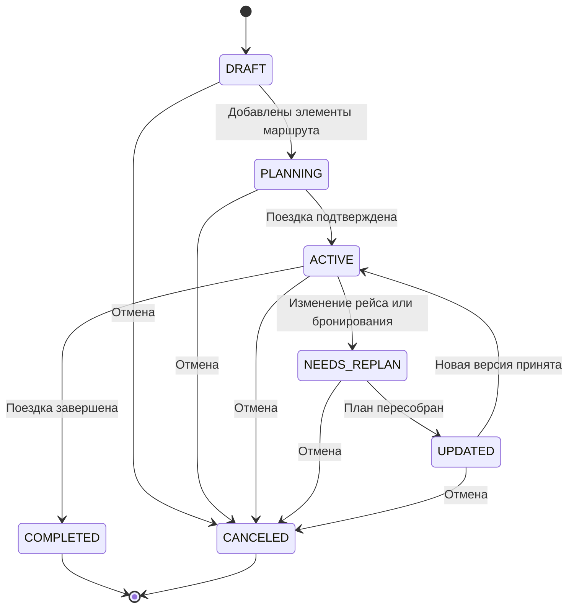

# Бизнес-правила

## 1. Назначение документа

Документ фиксирует правила, по которым система принимает решения при планировании поездки и пересборке маршрута.

---

## 2. Общие правила

| ID | Правило |
|---|---|
| BR-001 | Поездка должна иметь хотя бы одного владельца. |
| BR-002 | Участник группы может видеть только те поездки, к которым ему предоставлен доступ. |
| BR-003 | Каждый элемент маршрута должен быть привязан к конкретной поездке. |
| BR-004 | Все изменения плана должны сохранять историю версий. |
| BR-005 | Если источник рейса сообщает задержку или отмену, система должна создать событие изменения. |

---

## 3. Правила альтернатив

| ID | Правило |
|---|---|
| BR-006 | Альтернативы должны учитывать багаж, визовые ограничения и тайм-зоны. |
| BR-007 | Альтернатива не может быть предложена, если она нарушает обязательные ограничения поездки. |
| BR-008 | Приоритет получают варианты, которые минимально изменяют уже согласованный маршрут. |
| BR-009 | Если доступно несколько альтернатив, система может ранжировать их по времени, цене и удобству. |
| BR-010 | Если альтернативы отсутствуют, система должна сообщить об этом пользователю. |

---

## 4. Правила групповой поездки

| ID | Правило |
|---|---|
| BR-011 | В групповой поездке изменения общего плана должны фиксироваться только после согласования по правилам доступа. |
| BR-012 | Участник с правом редактирования может предложить изменение, но не обязан единолично его утверждать. |
| BR-013 | При конфликте правок система должна сохранить обе версии до разрешения конфликта. |
| BR-014 | Все участники должны видеть актуальную версию маршрута после синхронизации. |

---

## 5. Правила офлайн-режима

| ID | Правило |
|---|---|
| BR-015 | Офлайн-изменения сохраняются локально и не считаются окончательно применёнными до синхронизации. |
| BR-016 | При синхронизации локальные изменения должны проходить проверку конфликтов. |
| BR-017 | Если локальное изменение устарело, система должна предложить пользователю выбрать действие. |

---

## 6. Правила работы с персональными данными

| ID | Правило |
|---|---|
| BR-018 | Паспортные данные используются только для бронирования и связанных проверок. |
| BR-019 | После завершения поездки или истечения необходимости данные должны быть удалены или обезличены. |
| BR-020 | Доступ к чувствительным данным должен быть ограничен минимально необходимым набором ролей. |

---

## 7. Правила статусов

### 7.1. Статусы поездки

| Статус | Описание |
|---|---|
| DRAFT | Поездка создана, но ещё не заполнена |
| PLANNING | В поездку добавляются элементы маршрута |
| ACTIVE | Поездка подтверждена и используется |
| NEEDS_REPLAN | Обнаружено событие, требующее пересборки маршрута |
| UPDATED | Маршрут обновлён после изменения |
| COMPLETED | Поездка завершена |
| CANCELED | Поездка отменена |

### 7.2. Статусы бронирования

| Статус | Описание |
|---|---|
| CREATED | Бронирование создано |
| ON_HOLD | Данные ожидают подтверждения |
| CONFIRMED | Бронирование подтверждено |
| TICKETED | Билет или ваучер выпущен |
| CANCELED | Бронирование отменено |
| FAILED | Бронирование не выполнено |

### 7.3. Статусы уведомления

| Статус | Описание |
|---|---|
| NEW | Уведомление создано |
| SENT | Отправлено пользователю |
| DELIVERED | Доставлено |
| ACKED | Подтверждено приложением |
| RESOLVED | Событие обработано |
| EXPIRED | Уведомление устарело |

---

## 8. Диаграмма состояний поездки

Исходный код диаграммы: [trip-state.mmd](../diagrams/mermaid/trip-state.mmd).

---

## 9. Открытые вопросы

1. Кто имеет право утверждать изменения в групповой поездке?
2. Какие альтернативы считаются допустимыми по умолчанию?
3. Как долго хранить версии маршрута после завершения поездки?
4. Какие события требуют немедленного уведомления?
5. Когда поездка переводится в статус NEEDS_REPLAN?
