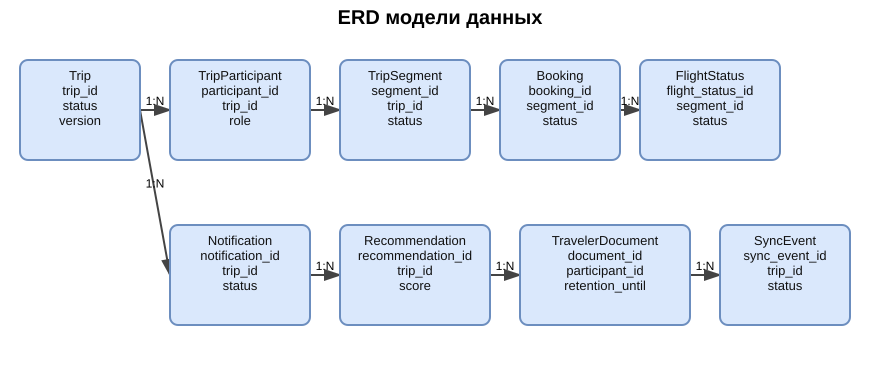

# Модель данных

## 1. Назначение документа

Документ описывает логическую модель данных сервиса планирования путешествий.

---

## 2. Принципы моделирования

1. Поездка, бронирование и уведомление являются разными сущностями.
2. У одной поездки может быть несколько участников и несколько сегментов маршрута.
3. У одного сегмента маршрута может быть несколько бронирований или вариантов.
4. История изменений хранится отдельно от текущего состояния.
5. Чувствительные данные должны быть минимизированы и ограничены по сроку хранения.
6. Все временные поля должны храниться в UTC.

---

## 3. Состав сущностей

| Сущность | Назначение |
|---|---|
| `Trip` | Основная сущность поездки |
| `TripParticipant` | Участник поездки |
| `TripSegment` | Сегмент маршрута |
| `Booking` | Бронирование элемента поездки |
| `FlightStatus` | Статус рейса и изменения |
| `Notification` | Уведомление о событии |
| `Recommendation` | Предложение альтернативы |
| `TravelerDocument` | Документ путешественника с ограниченным сроком хранения |
| `SyncEvent` | Событие синхронизации изменений |

---

## 4. Связи между сущностями

| От | К | Тип связи | Описание |
|---|---|---|---|
| `Trip` | `TripParticipant` | 1:N | У одной поездки несколько участников |
| `Trip` | `TripSegment` | 1:N | У поездки несколько сегментов маршрута |
| `TripSegment` | `Booking` | 1:N | У сегмента может быть несколько бронирований или альтернатив |
| `TripSegment` | `FlightStatus` | 1:N | Статусы рейса привязаны к сегменту перелёта |
| `Trip` | `Notification` | 1:N | У поездки несколько уведомлений |
| `Trip` | `Recommendation` | 1:N | У поездки несколько рекомендаций |
| `TripParticipant` | `TravelerDocument` | 1:N | Участник может иметь несколько документов |
| `Trip` | `SyncEvent` | 1:N | У поездки несколько событий синхронизации |

---

## 5. Описание сущностей

### 5.1. Trip

| Поле | Тип | Обязательность | Описание |
|---|---|---|---|
| `trip_id` | UUID | Да | Идентификатор поездки |
| `title` | String | Да | Название поездки |
| `destination` | String | Да | Направление |
| `start_date` | Date | Да | Дата начала |
| `end_date` | Date | Да | Дата окончания |
| `timezone` | String | Да | Основная часовая зона |
| `status` | Enum | Да | Текущий статус поездки |
| `created_at` | Timestamp | Да | Дата создания |
| `updated_at` | Timestamp | Да | Дата последнего изменения |
| `version` | Integer | Да | Номер версии маршрута |

### 5.2. TripParticipant

| Поле | Тип | Обязательность | Описание |
|---|---|---|---|
| `participant_id` | UUID | Да | Идентификатор участника |
| `trip_id` | UUID | Да | Ссылка на поездку |
| `user_id` | UUID | Нет | Ссылка на пользователя, если он зарегистрирован |
| `display_name` | String | Да | Имя для отображения |
| `role` | Enum | Да | Роль в поездке |
| `access_level` | Enum | Да | Уровень доступа |
| `created_at` | Timestamp | Да | Дата добавления |

### 5.3. TripSegment

| Поле | Тип | Обязательность | Описание |
|---|---|---|---|
| `segment_id` | UUID | Да | Идентификатор сегмента |
| `trip_id` | UUID | Да | Ссылка на поездку |
| `segment_type` | Enum | Да | Тип сегмента |
| `start_time_utc` | Timestamp | Да | Начало в UTC |
| `end_time_utc` | Timestamp | Да | Окончание в UTC |
| `status` | Enum | Да | Статус сегмента |
| `source_reference` | String | Нет | Ссылка на внешний источник |
| `updated_at` | Timestamp | Да | Последнее обновление |

### 5.4. Booking

| Поле | Тип | Обязательность | Описание |
|---|---|---|---|
| `booking_id` | UUID | Да | Идентификатор бронирования |
| `segment_id` | UUID | Да | Ссылка на сегмент |
| `provider_type` | Enum | Да | Тип поставщика |
| `provider_booking_ref` | String | Да | Внешняя ссылка на бронирование |
| `status` | Enum | Да | Статус бронирования |
| `price_amount` | Decimal | Да | Стоимость |
| `currency` | String | Да | Валюта |
| `created_at` | Timestamp | Да | Дата создания |
| `updated_at` | Timestamp | Да | Последнее изменение |

### 5.5. FlightStatus

| Поле | Тип | Обязательность | Описание |
|---|---|---|---|
| `flight_status_id` | UUID | Да | Идентификатор статуса |
| `segment_id` | UUID | Да | Ссылка на сегмент перелёта |
| `status` | Enum | Да | Статус рейса |
| `scheduled_departure` | Timestamp | Да | Плановое время |
| `actual_departure` | Timestamp | Нет | Фактическое время |
| `delay_minutes` | Integer | Нет | Задержка в минутах |
| `source_updated_at` | Timestamp | Да | Время у поставщика |

### 5.6. Notification

| Поле | Тип | Обязательность | Описание |
|---|---|---|---|
| `notification_id` | UUID | Да | Идентификатор уведомления |
| `trip_id` | UUID | Да | Ссылка на поездку |
| `participant_id` | UUID | Нет | Ссылка на получателя |
| `notification_type` | Enum | Да | Тип уведомления |
| `status` | Enum | Да | Статус доставки |
| `message_text` | String | Да | Текст сообщения |
| `created_at` | Timestamp | Да | Дата создания |
| `sent_at` | Timestamp | Нет | Дата отправки |
| `delivered_at` | Timestamp | Нет | Дата доставки |

### 5.7. Recommendation

| Поле | Тип | Обязательность | Описание |
|---|---|---|---|
| `recommendation_id` | UUID | Да | Идентификатор рекомендации |
| `trip_id` | UUID | Да | Ссылка на поездку |
| `segment_id` | UUID | Нет | Ссылка на затронутый сегмент |
| `recommendation_type` | Enum | Да | Тип предложения |
| `status` | Enum | Да | Статус рекомендации |
| `score` | Decimal | Нет | Рейтинг релевантности |
| `created_at` | Timestamp | Да | Дата создания |
| `expires_at` | Timestamp | Нет | Срок действия |

### 5.8. TravelerDocument

| Поле | Тип | Обязательность | Описание |
|---|---|---|---|
| `document_id` | UUID | Да | Идентификатор документа |
| `participant_id` | UUID | Да | Ссылка на участника |
| `document_type` | Enum | Да | Тип документа |
| `document_number` | String | Да | Номер документа |
| `country_code` | String | Да | Страна выдачи |
| `valid_until` | Date | Да | Срок действия |
| `retention_until` | Timestamp | Да | До какого времени допускается хранение |
| `status` | Enum | Да | Статус документа |

### 5.9. SyncEvent

| Поле | Тип | Обязательность | Описание |
|---|---|---|---|
| `sync_event_id` | UUID | Да | Идентификатор события синхронизации |
| `trip_id` | UUID | Да | Ссылка на поездку |
| `event_type` | Enum | Да | Тип изменения |
| `status` | Enum | Да | Статус синхронизации |
| `device_id` | String | Нет | Устройство, если применимо |
| `created_at` | Timestamp | Да | Дата и время |
| `processed_at` | Timestamp | Нет | Время обработки |

---

## 6. Ограничения целостности

1. Нельзя создать сегмент без поездки.
2. Нельзя создать бронирование без сегмента.
3. Нельзя хранить документ после окончания срока необходимости.
4. Нельзя обновить поездку без увеличения версии маршрута.
5. Нельзя допустить несогласованное изменение без конфликта или явного подтверждения.
6. Все события должны быть трассируемыми по версии поездки.

---

## 7. Связь с бизнес-правилами

Модель данных поддерживает:
- версионность маршрута;
- историю изменений;
- групповой режим;
- офлайн-синхронизацию;
- ограничение хранения паспортных данных;
- хранение уведомлений и альтернатив.

---

## 8. Диаграмма ERD

Исходник диаграммы: [erd-travel-model.drawio](../diagrams/drawio/erd-travel-model.drawio).

---

## 9. Открытые вопросы

1. Нужна ли отдельная сущность для истории версий маршрута?
2. Хранить ли локальные изменения отдельно от серверных?
3. Нужна ли сущность для правил визового соответствия?
4. Какие поля паспорта хранить, а какие использовать только транзитом?
5. Нужна ли отдельная сущность для рекомендаций по активностям и отдельная — по перелётам?
