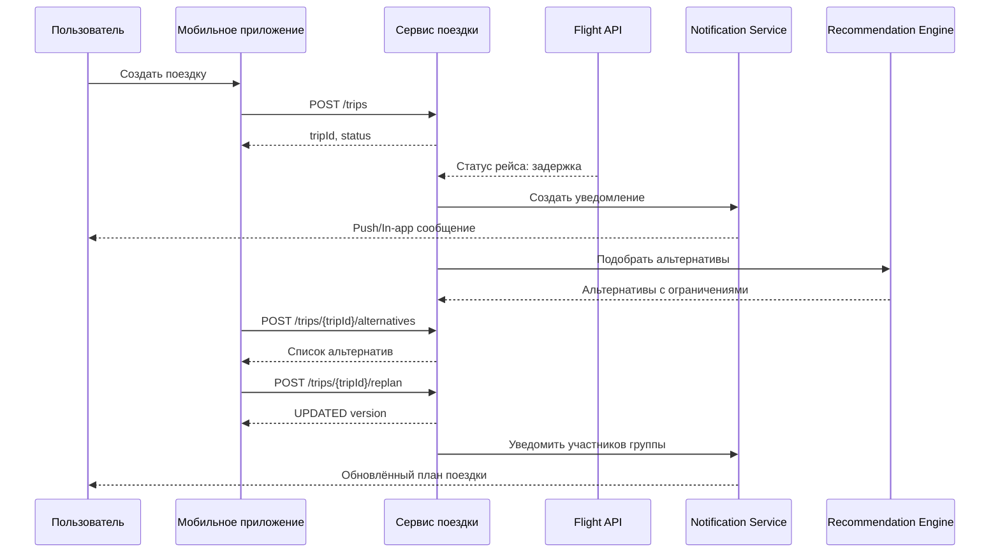
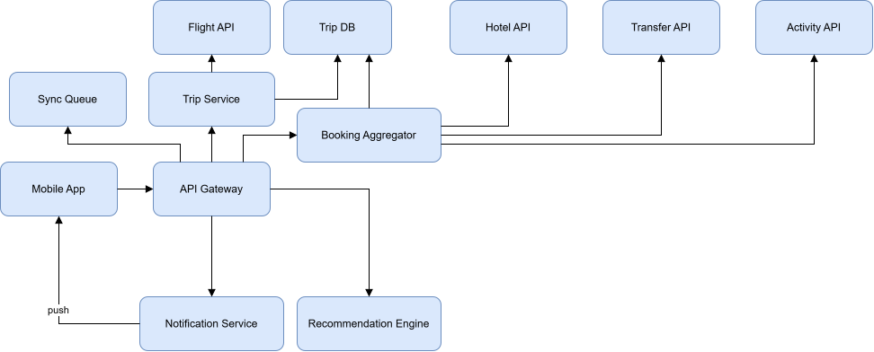

# API

## 1. Назначение документа

Документ описывает основные интерфейсы сервиса планирования путешествий.

---

## 2. Общие принципы

1. API версионируется через `v1`.
2. Формат обмена — JSON.
3. Идентификаторы передаются в формате UUID.
4. Все время передаётся в ISO 8601 и хранится в UTC.
5. Изменяющие запросы должны поддерживать идемпотентность.
6. Ошибки возвращаются в структурированном формате.

---

## 3. Общий формат ошибки

```json
{
  "error": {
    "code": "INVALID_REQUEST",
    "message": "Некорректные параметры",
    "details": [
      {
        "field": "startDate",
        "issue": "Дата начала поездки обязательна"
      }
    ],
    "requestId": "c0db8a6f-88fe-4fd1-a0ad-4d2d4f0f1b2a",
    "timestamp": "2026-11-02T10:00:00Z"
  }
}
```

---

## 4. Создание поездки

### Endpoint
`POST /api/v1/trips`

### Тело запроса
```json
{
  "title": "Поездка в Рим",
  "destination": "Rome",
  "startDate": "2026-12-05",
  "endDate": "2026-12-12",
  "timezone": "Europe/Rome"
}
```

### Ответ
```json
{
  "tripId": "1b0a0a86-6b8a-4d55-a78a-49d8c9f4cf71",
  "status": "DRAFT",
  "version": 1,
  "createdAt": "2026-11-02T10:00:00Z"
}
```

---

## 5. Добавление участника

### Endpoint
`POST /api/v1/trips/{tripId}/participants`

### Тело запроса
```json
{
  "displayName": "Анна",
  "role": "MEMBER",
  "accessLevel": "EDITOR"
}
```

---

## 6. Поиск вариантов

### Endpoint
`GET /api/v1/search`

### Query-параметры
- `type=flight|hotel|transfer|activity`
- `destination`
- `startDate`
- `endDate`
- `passengers`
- `timezone`

### Ответ
Список вариантов с ценой, ограничениями и временем.

---

## 7. Создание бронирования

### Endpoint
`POST /api/v1/bookings`

### Тело запроса
```json
{
  "tripId": "1b0a0a86-6b8a-4d55-a78a-49d8c9f4cf71",
  "segmentId": "6e5f2e2d-6e0d-4b7f-86b7-6fb4edbf8ec2",
  "providerType": "FLIGHT",
  "providerOptionId": "OPT-12345"
}
```

### Ответ
```json
{
  "bookingId": "f30b7d4c-9e5d-4e1a-9e2a-5eeb4fce0f23",
  "status": "CONFIRMED",
  "providerBookingRef": "PNR-778899",
  "createdAt": "2026-11-02T10:00:00Z"
}
```

---

## 8. Получение статуса рейса

### Endpoint
`GET /api/v1/flights/{flightId}/status`

### Ответ
```json
{
  "flightId": "FL-1001",
  "status": "DELAYED",
  "scheduledDeparture": "2026-12-05T08:10:00Z",
  "actualDeparture": "2026-12-05T09:05:00Z",
  "delayMinutes": 55,
  "sourceUpdatedAt": "2026-11-02T09:58:00Z"
}
```

---

## 9. Получение уведомлений

### Endpoint
`GET /api/v1/trips/{tripId}/notifications`

### Ответ
Список уведомлений по поездке с актуальными статусами доставки.

---

## 10. Предложение альтернативы

### Endpoint
`POST /api/v1/trips/{tripId}/alternatives`

### Тело запроса
```json
{
  "segmentId": "6e5f2e2d-6e0d-4b7f-86b7-6fb4edbf8ec2",
  "reason": "FLIGHT_DELAY"
}
```

### Ответ
```json
{
  "alternatives": [
    {
      "type": "FLIGHT",
      "optionId": "ALT-001",
      "score": 0.94,
      "constraints": {
        "baggageIncluded": true,
        "visaRequired": false,
        "timezoneDeltaHours": 1
      }
    }
  ]
}
```

---

## 11. Обновление плана поездки

### Endpoint
`POST /api/v1/trips/{tripId}/replan`

### Тело запроса
```json
{
  "selectedAlternativeId": "ALT-001",
  "version": 3
}
```

### Ответ
```json
{
  "tripId": "1b0a0a86-6b8a-4d55-a78a-49d8c9f4cf71",
  "status": "UPDATED",
  "version": 4,
  "updatedAt": "2026-11-02T10:05:00Z"
}
```

---

## 12. Синхронизация офлайн-изменений

### Endpoint
`POST /api/v1/trips/{tripId}/sync`

### Назначение
Передать накопленные локальные изменения после восстановления связи.

---

## 13. Связь с последовательностью

Исходник диаграммы: [sequence-travel-planning.mmd](../diagrams/mermaid/sequence-travel-planning.mmd).



---

## 14. Открытые вопросы

1. Нужен ли отдельный endpoint для согласования изменений группой?
2. Нужно ли получать статус рейса по расписанию или только по событиям?
3. Какие поля доступны в публичном ответе для участника группы?
4. Нужен ли endpoint для удаления персональных данных после завершения поездки?
5. Какой контракт должен использоваться для webhook от внешних поставщиков?


---

## Архитектурная диаграмма

Исходник: [architecture.drawio](../diagrams/drawio/architecture.drawio).


